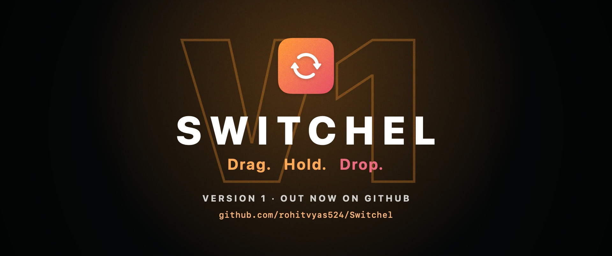
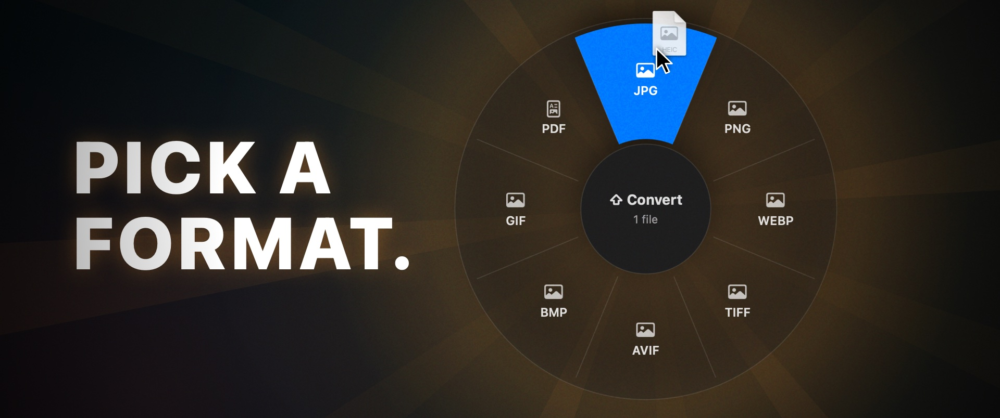
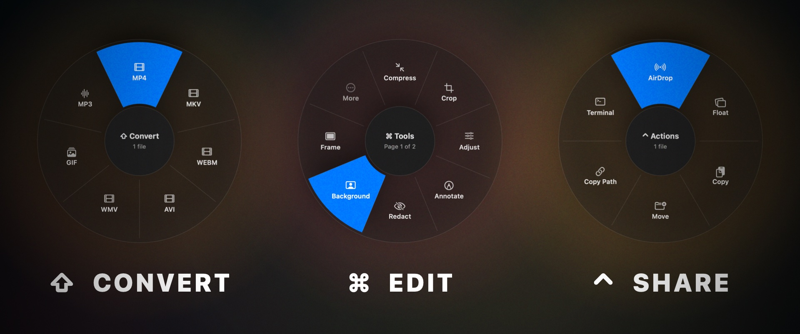

# Switchel



A menu-bar file converter and toolbox for macOS. Drag files anywhere, hold a key, and drop on a slice of the wheel. Everything runs locally. Results are saved next to the original (or in a folder you choose), and the original is never changed.

## Download

**[⬇ Download Switchel for macOS](https://github.com/rohitvyas524/Switchel/releases/latest/download/Switchel.zip)** (macOS 14+, Apple silicon) · [All releases](https://github.com/rohitvyas524/Switchel/releases)

1. Unzip and drag **Switchel.app** to your Applications folder.
2. The app isn't notarized, so macOS blocks it the first time you open it. Go to **System Settings › Privacy & Security**, scroll down, and click **Open Anyway**. On macOS 14 you can instead right-click the app and choose **Open**. Or run `xattr -dr com.apple.quarantine /Applications/Switchel.app` in Terminal.

## How it works



| Default key | Wheel | What's on it |
|---|---|---|
| ⇧ Shift | Convert | The formats each file can become (see below) |
| ⌘ Command | Tools | Editors and one-click tools for the file type |
| ⌃ Control | Actions | AirDrop, Float, Copy, Move, Copy Path, Terminal; works on folders and mixed selections |

You can change the keys, turn wheels off, and set a global shortcut that opens the wheel for the current Finder selection (← → to choose, Tab to switch wheels, Return to apply). These are in the first-launch wizard and in **Settings**.



## Conversions

| From | To |
|---|---|
| Images (JPG, PNG, WebP, HEIC, TIFF, AVIF, BMP, GIF; SVG, ICO, PSD in) | JPG, PNG, WebP, HEIC, TIFF, AVIF, BMP, GIF, PDF |
| Video (MP4, MOV, MKV, WebM, AVI, WMV, …) | MP4, MOV, MKV, WebM, AVI, WMV, GIF, MP3 |
| Audio (MP3, M4A, WAV, FLAC, OGG, Opus, AIFF, WMA, …) | MP3, M4A, WAV, FLAC, OGG, Opus, AIFF, WMA |
| PDF | DOCX, Pages, PPTX, XLSX, JPG, PNG (300 DPI), EPUB, TXT, Markdown |
| Documents (DOCX, DOC, ODT, RTF, RTFD, HTML, TXT, Markdown, EPUB, Pages, text clippings) | DOCX, Pages, Markdown, TXT, EPUB, HTML, RTF, ODT, PDF |
| Spreadsheets (XLSX, ODS, CSV, TSV; XLS, Numbers in) | XLSX, ODS, CSV, TSV, PDF |
| Slides (PPTX, PPT, Keynote) | PDF, JPG, PNG |
| Subtitles (SRT, VTT) | SRT, VTT, TXT |
| Archives (ZIP, TAR, GZIP; RAR, 7z in) and folders | ZIP, TAR, TAR.GZ |

## Tools

- **Images:** Compress (by quality or target size), Crop, Annotate, Redact (with face and text detection), Background (remove or replace), Frame, Metadata (view, edit, strip losslessly), Collage, QR Code reader, Icon (.icns), Rotate, Make/Combine PDF
- **Video:** Compress (strength or target size, resolution cap), Trim, Split, Speed, Redact (timed regions), Snapshots, Merge, Mute
- **Audio:** Compress, Trim (with automatic silence trimming), Normalize volume, Channels, Bleep, Visualize (audio → waveform video), Merge
- **PDF:** Merge, Compress, Pages (reorder, rotate, delete), Split
- **Archives:** Extract

## Engines

Images, PDFs, documents, spreadsheets, subtitles and archives need nothing extra. These optional engines unlock the rest, and **Settings › Engines** shows which ones are found:

| Engine | Unlocks | Get it |
|---|---|---|
| ffmpeg | Every audio/video tool, and MKV, WebM, AVI, WMV, MP3, FLAC, OGG, Opus, WMA | `brew install ffmpeg` |
| cwebp | WebP export | `brew install webp` |
| Pages, Keynote, Numbers | .pages, .key, .numbers, PowerPoint and .xls files | Free on the Mac App Store |

Switchel asks once for Automation permission the first time it uses Pages, Keynote, Numbers or Finder.

## Build

Requires macOS 14+ on Apple silicon and Xcode 15+.

```sh
swift test                  # 26 tests over every converter and tool engine (media tests need ffmpeg)
./scripts/build-app.sh      # → build/Switchel.app and build/Switchel.zip
open build/Switchel.app
```

To publish a release, attach `build/Switchel.zip` to a new GitHub release. Keep the name `Switchel.zip` so the download link above keeps working. `swift scripts/make-icon.swift` regenerates `Resources/AppIcon.icns`.

## Layout

- `Sources/SwitchelKit/Core`: file kinds, output naming, shell/ffmpeg runner
- `Sources/SwitchelKit/Convert`: one converter per family, plus the hand-written EPUB/XLSX/ODS/PPTX packages and the iWork bridge
- `Sources/SwitchelKit/Tools`: image, audio/video and PDF tool engines (no UI)
- `Sources/SwitchelKit/Editors`: SwiftUI editor windows for the tools
- `Sources/SwitchelKit/App`: drag monitor, wheel, Float shelf, settings, welcome wizard, menu bar
